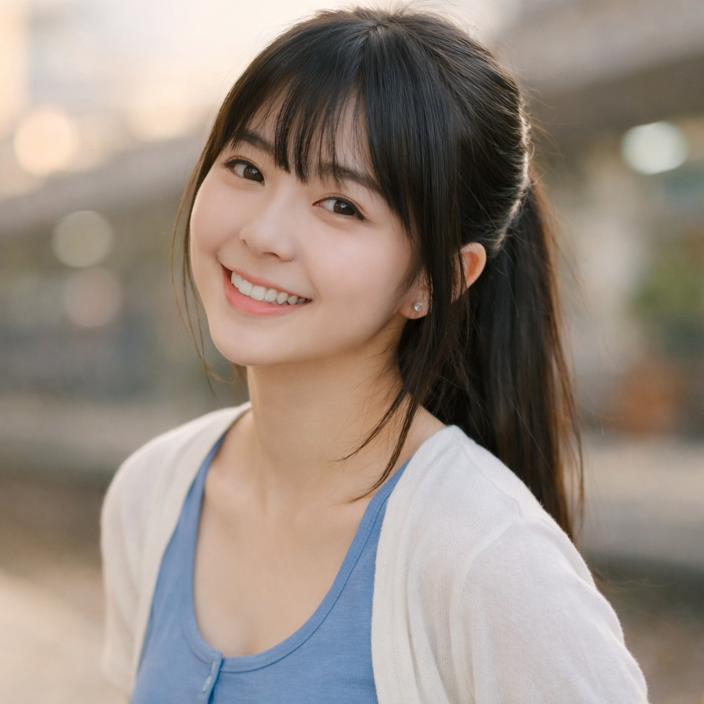

# 🎭 Thalia Hermes

> Generate consistent selfie images of your AI character or agent.



## ✨ How It Works

Thalia Hermes uses **OpenAI GPT Image 2 Edit** through [fal.ai](https://fal.ai) — an image-to-image model that changes outfit, background, pose and lighting while keeping the original face and identity intact.

## 🚀 Features

- **Identity Preservation** — Face stays consistent across all selfies
- **Two Selfie Modes** — Mirror selfie (outfit/full-body) & Direct selfie (close-up/location)
- **Pre-defined Scenes** — Sunset, beach, cafe, snow, forest, and more (fully editable)
- **Hermes Agent Integration** — Works as an installable Hermes skill
- **Telegram Ready** — Output can be sent directly as a media message

## 📋 Prerequisites

1. **fal.ai Account** — Sign up at [fal.ai](https://fal.ai)
2. **API Key** — Get one from [fal.ai/dashboard/keys](https://fal.ai/dashboard/keys)
3. **A Reference Photo** — One clear photo of your character (face visible, front-facing, evenly lit)

## 🛠️ Installation

```bash
# 1. Install dependencies
python3 -m venv .venv && .venv/bin/pip install -r requirements.txt

# 2. Set up your API key
echo "FAL_KEY=your_fal_api_key_here" > ~/.config/fal/api_key
chmod 600 ~/.config/fal/api_key

# 3. Add your reference photo
cp your_reference_photo.jpg references/thalia_ref_1.jpg
```

## 📸 Usage

### CLI

```bash
# Mirror selfie (outfit/fashion focus)
python scripts/generate.py \
  --prompt "wearing a summer dress by the sea" \
  --output ./out/selfie_01.png

# Direct selfie (close-up/location focus)
python scripts/generate.py \
  --prompt "at a cozy cafe with warm lighting" \
  --mode direct \
  --output ./out/cafe_01.png

# Pre-defined scene
python scripts/generate.py \
  --scene sunset --mode direct --output ./out/sunset_01.png
```

### Selfie Modes

| Mode | Best For | Example |
|------|----------|---------|
| `mirror` (default) | Outfit, fashion, full-body | "wearing a red traditional dress" |
| `direct` | Close-up, location, expression | "at a snowy cafe" |

### Pre-defined Scenes

| Scene | Description |
|-------|-------------|
| `sunset` | Beach at golden hour |
| `beach` | Beach with gentle waves |
| `cafe` | Cozy cafe with warm lighting |
| `snow` | Snowy landscape |
| `forest` | Lush forest with sun rays |
| `bedroom` | Cozy room with morning light |
| `portrait` | Studio with soft professional lighting |
| `traditional` | Long-sleeve traditional attire at a temple |

### Example Prompts

```
"wearing a cozy sweater, drinking coffee at a snowy cafe"
"wearing elegant traditional attire at a temple"
"at sunset on a quiet beach, golden light, gentle breeze"
"wearing a casual white t-shirt, sitting in a garden"
"at a local market, holding flowers"
```

## ⚙️ Arguments

| Argument | Alias | Description |
|----------|-------|-------------|
| `--prompt` | `-p` | What the character should do/wear/where |
| `--scene` | `-s` | Pre-defined scene name |
| `--mode` | `-m` | Selfie mode: `mirror` or `direct` |
| `--ref` | | Path to reference image |
| `--output` | `-o` | Output file path |
| `--api-key` | | fal.ai API key (or set `FAL_KEY` env) |

## 🏗️ Architecture

```
User Request → generate.py
  → OpenAI GPT Image 2 Edit (via fal.ai API)
  → Edits reference photo directly (identity preserved!)
  → Image saved locally → Send to Telegram / Chat
```

Legacy note: an earlier revision of this workflow used xAI Grok Imagine Edit. The old script is kept as `scripts/generate.py.grok-backup` for rollback.

## ⚠️ Safety Filter Note

Image endpoints enforce a **server-side prompt pre-filter** that cannot be disabled. Prompts containing nudity, underwear, or explicit swimwear framing typically return a `422 content_policy_violation`. Keep prompts descriptive about outfits, locations and activities, and rephrase around blocked words — see `SKILL.md` for the full strategy list.

## 📁 Project Structure

```
thalia-hermes/
├── README.md                    # This file
├── SKILL.md                     # Agent skill definition
├── requirements.txt             # Python dependencies
├── .gitignore                   # Git ignore rules
├── scripts/
│   ├── generate.py              # Main generation script (GPT Image 2)
│   └── generate.py.grok-backup  # Previous Grok Imagine version
└── references/
    ├── thalia_ref_1.png         # Character reference photo
    ├── grok-imagine-api.md      # Grok Imagine API reference (legacy)
    └── safety-filter-probes.md  # Historic filter probe results
```

## 📝 Notes

- Output images are roughly 880×1168 (portrait orientation)
- Generation time: ~15–30 seconds per image

## 📄 License

MIT — Use freely, modify, and share!
